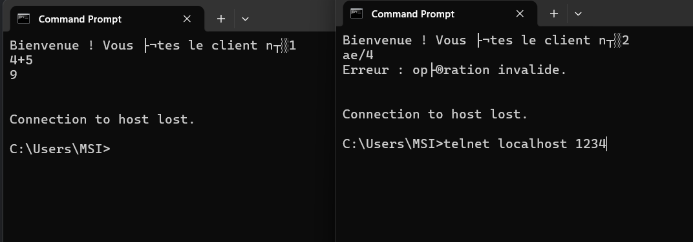
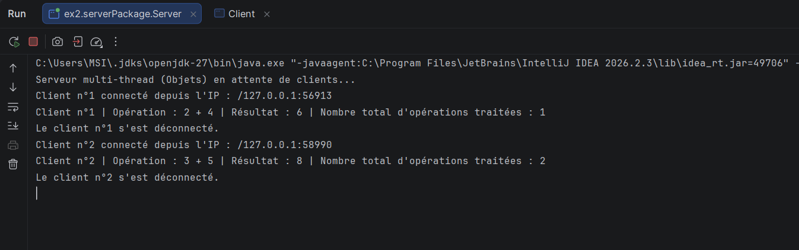
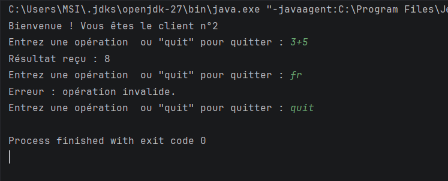

# TP 3 : Serveur Multi-threads - sockets en mode connecté TCP

**Membre du groupe :**
Ben Maalem Yassine
LSI3 3 G2

## Activité 3-1 : Acceptation de plusieurs clients

### Objectif
L'objectif de cette activité est de modifier le squelette de communication Client/Serveur développé dans les TP précédents afin de concevoir un véritable serveur capable de traiter plusieurs clients simultanément, en utilisant les threads et les sockets TCP.

### Étape 1 : Création d'un serveur multi-thread
**Objectif :**
Développer un serveur multi-thread capable de gérer plusieurs clients simultanément, afficher leur adresse IP et leur numéro d'ordre de connexion, et envoyer ce numéro à chaque client dès sa connexion.

**Fonctionnement :**
Le serveur principal utilise une boucle infinie `while (true)` sur la méthode `accept()`. À chaque nouvelle connexion, une instance de la classe `ClientProcess` (qui hérite de `Thread`) est créée et démarrée via la méthode `start()`. Cela permet au thread principal de retourner immédiatement à l'écoute sans bloquer les autres clients.

### Étape 2 : Tests locaux
**Test de l'acceptation simultanée :**
Pour tester le serveur, nous avons utilisé l'outil Telnet pour simuler plusieurs clients connectés en même temps sur le port `1244` en local.

Capture d'écran du test multi-clients :

**Interprétation :**
La capture d'écran montre que le serveur gère correctement plusieurs clients en parallèle :
1. Le **Client n°1** a envoyé l'opération `4+5` et a reçu le résultat correct `9`.
2. Le **Client n°2** s'est connecté simultanément, a reçu son numéro d'ordre de communication, et a envoyé une chaîne invalide `ae/4`, ce qui a déclenché le message d'erreur de validation de la syntaxe.
   Côté console du serveur, l'adresse IP et le numéro d'ordre de chaque client connecté sont affichés avec succès.

### Étape 3 : Tests en réseau local
*(Cette étape consiste à tester la connexion entre plusieurs machines du même réseau en utilisant les classes `InetAddress` et `InetSocketAddress` côté client Java).*

### Résultat de l'activité
Le passage d'un serveur mono-client à un serveur multi-threads a été réalisé avec succès. L'utilisation d'un thread dédié (`ClientProcess`) pour chaque socket acceptée permet au serveur de traiter plusieurs requêtes simultanément sans aucun blocage. Le service de calculatrice est désormais capable de servir plusieurs clients en parallèle tout en maintenant l'identification et l'isolation de chaque connexion.

---

## Activité 3-2 : Amélioration de l'application de calculatrice

### Objectif
L'objectif de cette activité est de transformer le service de calculatrice du TP2 (communication par objets sérialisés) en un serveur multi-thread capable de servir plusieurs clients simultanément, avec un compteur global d'opérations partagé et synchronisé entre les threads.

### Étape 1 : Serveur multi-thread avec communication par objets

Fonctionnement :
Le serveur (Server.java) boucle sur accept() et crée, pour chaque client connecté, un thread dédié ClientProcess. La communication se fait par objets sérialisés : le client envoie des objets Operation (implements Serializable) via ObjectOutputStream, et le serveur renvoie le résultat via ObjectOutputStream / ObjectInputStream. Le client ouvre une session interactive : il peut envoyer plusieurs opérations dans la même connexion, et la saisie de "quit" envoie un objet null qui signale la fin de la session au serveur. La classe Client utilise InetAddress et InetSocketAddress pour pouvoir se connecter à un serveur distant sur le réseau local.

### Test local

Capture d'écran du serveur (deux clients servis en parallèle) :

Capture d'écran du client n°2 (session interactive) :

Interprétation :
Le serveur a accepté deux clients simultanément. Le client n°1 a envoyé l'opération 2+4 et a reçu 6, puis s'est déconnecté. Le client n°2 a reçu son numéro d'ordre dès la connexion, a envoyé 3+5 et a reçu 8. Lorsque le client n°2 a saisi une chaîne invalide (fr), la validation locale par expression régulière côté client a bloqué l'envoi et affiché un message d'erreur sans contacter le serveur. La commande quit a ensuite fermé proprement la session. Les threads ont travaillé en parallèle sans se bloquer mutuellement.

### Gestion d'un accès concurrent : compteur global synchronisé

Fonctionnement :
Un objet Compteur unique est créé dans le serveur et transmis à chaque thread ClientProcess via le constructeur. Cette variable partagée est une ressource critique : sa méthode incrementer() est déclarée synchronized afin d'éviter les conflits d'accès concurrents. Après chaque opération calculée, le compteur est incrémenté et sa nouvelle valeur est affichée dans la console du serveur.

Interprétation :
Comme le montre la capture du serveur, le compteur global est passé de 1 (après l'opération du client n°1) à 2 (après l'opération du client n°2). L'incrémentation reste cohérente grâce au mot-clé synchronized qui garantit qu'un seul thread à la fois modifie le compteur partagé.

### Test en réseau local

Fonctionnement :
Le client se connecte au serveur via InetAddress.getByName() et InetSocketAddress. Pour tester entre deux machines, il suffit de remplacer "localhost" par l'adresse IP du serveur (obtenue par la commande ipconfig) dans la classe Client, puis de lancer le serveur sur une machine et les clients sur les autres.

### Résultat de l'activité
Le service de calculatrice a été transformé avec succès en serveur multi-thread communiquant par objets. Chaque client est servi par un thread dédié dans une session interactive (plusieurs opérations possibles avant quit), et l'accès au compteur global d'opérations est correctement synchronisé. Le service fonctionne en local et reste adaptable au réseau local via InetAddress et InetSocketAddress.